# Simulated Squad: XP and Level Settlement

> When a 50v50 match ends, every player gets the XP they earned, exactly
> once, and moves up the right number of levels, even when the dedicated
> server retries its report or two writes race.

This is a **simulation**: an XP and level system for a *Squad*-like 50v50
game, written to show how such a backend is built. It implements the core
algorithms and defines everything else as interfaces, with diagrams.

**It does not describe the real game.** It is not affiliated with Offworld
Industries or Tencent. Every rule, curve and number here is invented. What
is publicly known about the real game, and how carefully it was checked,
is in [section 1](#1-background).

---

## Contents

1. [Background](#1-background)
2. [Our own service, or a platform feature?](#2-our-own-service-or-a-platform-feature)
3. [The big picture](#3-the-big-picture)
4. [The level curve](#4-the-level-curve)
5. [XP from a match](#5-xp-from-a-match)
6. [Settlement](#6-settlement)
7. [Telling the client: level-up events](#7-telling-the-client-level-up-events)
8. [RPC contracts](#8-rpc-contracts)
9. [Database](#9-database)
10. [Mapping to TcaplusDB](#10-mapping-to-tcaplusdb)
11. [A worked example](#11-a-worked-example)
12. [The code](#12-the-code)
13. [Assumptions and limitations](#13-assumptions-and-limitations)
14. [Sources](#14-sources)

---

## 1. Background

### What is publicly known

*Squad*'s China edition is called *战术小队：破晓攻势*. When this was
written (**2026-10-18**), no launch announcement was found; everything
below comes from its announcement, a media preview held before launch, and
the global game's official notes. Each claim lists **how solid it is**:

- **Official**: stated by the developer or publisher, or a public record.
- **Seen in preview**: a journalist played a preview build and reported it.
- **Reported**: written by a journalist without saying they saw it.
- **Planned**: presented as a plan or as provisional.

**China edition**

| Claim | How solid | Source |
|---|---|---|
| Developed by Offworld Industries (世外工作室), published by Tencent; import licence granted 2025-06-23 | Official (public licence record, as listed by Baidu Baike) | [Baidu Baike](https://baike.baidu.com/item/%E6%88%98%E6%9C%AF%E5%B0%8F%E9%98%9F%EF%BC%9A%E7%A0%B4%E6%99%93%E6%94%BB%E5%8A%BF/65814456), [Chuapp](https://www.chuapp.com/article/291383.html) |
| First shown at Tencent's showcase on 2026-05-27, with pre-registration and test sign-ups | Official (the event), as reported | [Chuapp](https://www.chuapp.com/article/291383.html) |
| Adds a progression system (成长系统), ranked play (排位系统), a career system (生涯系统) and achievements/medals (成就勋章系统) | Seen in preview | [游戏日报, 2026-05-28](https://www.sohu.com/a/1028663636_118576) |
| Tiered team-kill warnings, and a report system for victims of deliberate team kills | Seen in preview | [游戏日报, 2026-05-28](https://www.sohu.com/a/1028663636_118576) |
| 39 types of medals, including honours for logistics, support and command | Reported (two outlets) | [游研社, 2026-05-29](https://m.sohu.com/a/1029470443_628730/), [17173, 2026-05-30](https://news.17173.com/content/05302026/152503790.shtml) |
| Official matchmaking servers; free-to-play live service instead of a one-time purchase | Reported | [游研社, 2026-05-29](https://m.sohu.com/a/1029470443_628730/) |
| **军旅之路**: a community "veterans teach newcomers" path with three tracks (mentor, squad officer, academy professor) and cosmetic honours | Planned ("暂时", provisional, per the producer) | [Chuapp](https://www.chuapp.com/article/291383.html), [游研社](https://m.sohu.com/a/1029470443_628730/) |
| Mentor and newcomer rate each other after teaching matches; a seasonal clan league; linking the account to Steam playtime | Planned | [游研社, 2026-05-29](https://m.sohu.com/a/1029470443_628730/) |

**Global edition**

| Claim | How solid | Source |
|---|---|---|
| "We have no plans at this time for a traditional progression system", but a socially driven one is planned | Official, March 2024 | [Squad developer Q&A](https://www.joinsquad.com/updates/squad-developer-q-a---march-2024) |
| **Commendation System** (update 9.0, 2025-09-04): players award up to two commendations per round on licensed servers; ranks per role and for Leadership, Teacher and Teamwork; a Career screen | Official | [Squad 9.0 release notes](https://www.joinsquad.com/updates/squad-9-0-release-notes) |
| Games are found in a server browser of licensed and community servers | Community wiki | [Squad Wiki: Server browser](https://squad.fandom.com/wiki/Server_browser) |

### What this means for this demo

- The global game **does** have a form of progression: commendation ranks
  given by other players. So this demo does **not** claim that the global
  game has no progression.
- What public sources do not show for the global game is **XP earned from
  match performance that raises a level**. The China edition's preview
  build was reported to have a progression system, but **how it works (XP
  sources, curve, levels) is not public.**
- 军旅之路 is a community mentoring path, not an XP system. This demo is
  not a model of it.

So this demo simulates the most common form such a system takes, XP from
match results and levels from XP, because it starts from the moment every
long-term system needs: **a match ends and the dedicated server reports
what each of up to 100 players did.** It does only that:

- a player has **total XP** and a **level**;
- each match adds XP, computed by rules;
- enough XP reaches the next level.

What makes it a backend problem rather than a formula is doing that
**correctly** under retries, races and later rule changes.

### Words used in this document

| Word | Meaning |
|---|---|
| **DS** | Dedicated server: the Unreal server that runs one match. |
| **XP** | Experience points. Only ever added, never spent. |
| **level floor** | Total XP needed to reach a level. |
| **settlement** | Applying one match's XP to one player. |
| **idempotent** | Doing it twice has the same effect as doing it once. |
| **outbox** | A table of events written in the same transaction as the data, sent out later by a job. |
| **version check** | Write only if the row still has the version we read (optimistic locking). |

---

## 2. Our own service, or a platform feature?

**Our own service.** The rules (how much a revive is worth, how steep the
curve is) are the game's design and must be tuned freely. Tencent's InGame
platform publicly offers infrastructure, not a level system for our game.

What the platform provides, and how this demo treats it:

| Need | Provided by | Status | In this demo |
|---|---|---|---|
| Run the progression service | InGame runs microservices as pods that scale by CPU and memory | Publicly stated | Out of scope (see the shard handoff demo) |
| Store progress | TcaplusDB, key-value | Publicly stated | `ProgressStore` interface; SQL schema plus a TcaplusDB mapping |
| Receive match results | The DS calls our service | **Assumption** about the calling mechanism | `MatchResultRpc` |
| Know who the player is | The platform's login | **Assumption** | `sessionPlayerId` in `ProgressRpc` |
| Tell the client "level up" | A platform push channel | **Assumption** | `ClientNotifier` |
| Feed a season pass or statistics | InGame's roadmap lists BattlePass and Statistics services | **Assumption** that they accept our events | `PlatformEventSink` |

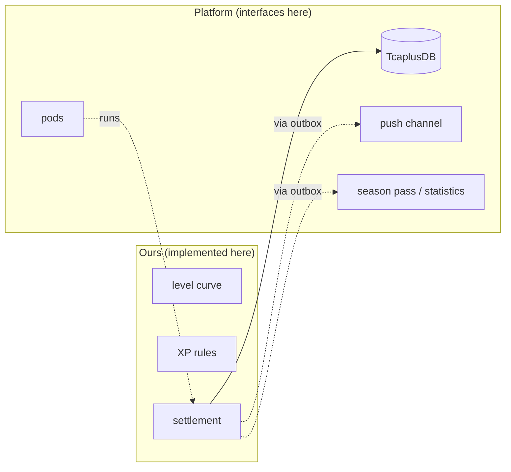

---

## 3. The big picture

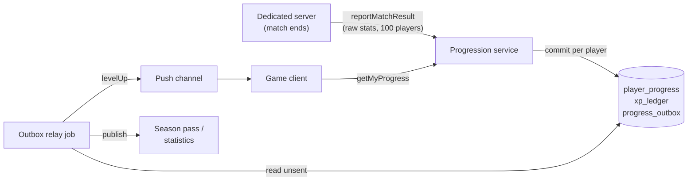

Two callers, two directions:

- **Backend in:** the DS reports raw facts when a match ends.
- **Frontend out:** the client asks for its progress bar, and is pushed a
  level-up when one happens.

---

## 4. The level curve

```
XP to go from level L to L+1  =  1000 + 150 × (L − 1)
```

| Level | Total XP to reach it | XP for this level |
|---|---|---|
| 1 | 0 | 1,000 |
| 2 | 1,000 | 1,150 |
| 3 | 2,150 | 1,300 |
| 4 | 3,450 | 1,450 |
| 5 | 4,900 | 1,600 |
| 10 | 14,400 | 2,350 |
| 20 | 44,650 | 3,850 |
| 30 | 89,900 | 5,350 |
| 50 | 225,400 | 8,350 |
| 100 (max) | 826,650 | n/a |

At about 1,400 XP per match (a good hour as a medic or logistics player),
level 10 takes about 11 matches, level 50 about 160, and level 100 about
590. Early levels come quickly; late levels mark real time served.

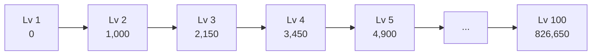

### Design choices

- **Store total XP, derive the level.** `levelFor(totalXp)` is a binary
  search over a precomputed table, `LEVEL_FLOOR`. Designers can replace the
  table with hand-tuned numbers, and nobody's stored XP has to be converted.
- **A level is never taken away.** If the curve is later made steeper, a
  player's total XP might now correspond to a lower level.
  `applyGain` keeps `max(old level, levelFor(new total))`, so a level once
  earned stays earned. Their progress bar simply starts empty until their
  XP catches up.
- **XP keeps counting after the max level.** Nothing is lost if the cap is
  raised later.

---

## 5. XP from a match

The DS sends **raw facts**; the backend turns them into XP. The rules can
then be tuned without shipping a new server build, and a modified client
cannot invent XP.

| Fact | XP |
|---|---|
| Each minute played (up to 90) | 10 |
| Stayed until the match ended | 200 |
| Kill | 20 |
| Revive | 50 |
| Supply delivered | 30 |
| Fortification built | 25 |
| Team kill | −100 |
| **Per match** | between 0 and 5,000 |

**Teamwork is worth more than kills.** In a *Squad*-like game, matches are
won by squads working together, not by individual kill counts. (Coverage
of the China edition also reports medals for logistics, support and
command roles; see section 1.) Four players in the same 60-minute match:

| Player | Did | XP |
|---|---|---|
| Medic | 3 kills, 10 revives | **1,360** |
| Logistics | 1 kill, 2 revives, 8 supply runs, 6 fortifications | **1,310** |
| Rifleman | 10 kills, 1 team kill | **900** |
| Left after 12 minutes | 2 kills | **160** |

**Caps and sanitizing.** 90 minutes at most stops AFK-farming; 5,000 per
match limits the damage of any exploit. Every input is cleaned first
(negative, fractional or missing numbers become whole numbers ≥ 0), so a
DS bug cannot become negative or absurd XP.

---

## 6. Settlement

### One player, one match

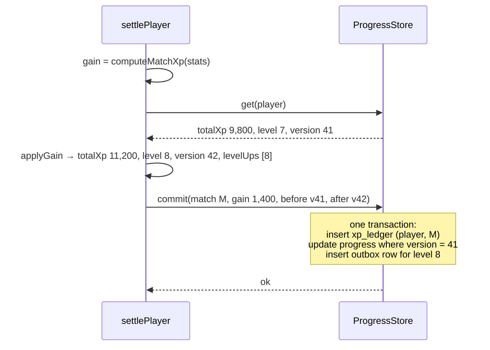

### Three problems, three guards

**1. The DS retries its report.** Networks fail; the DS sends the report
again. Without a guard, every player would be paid twice.

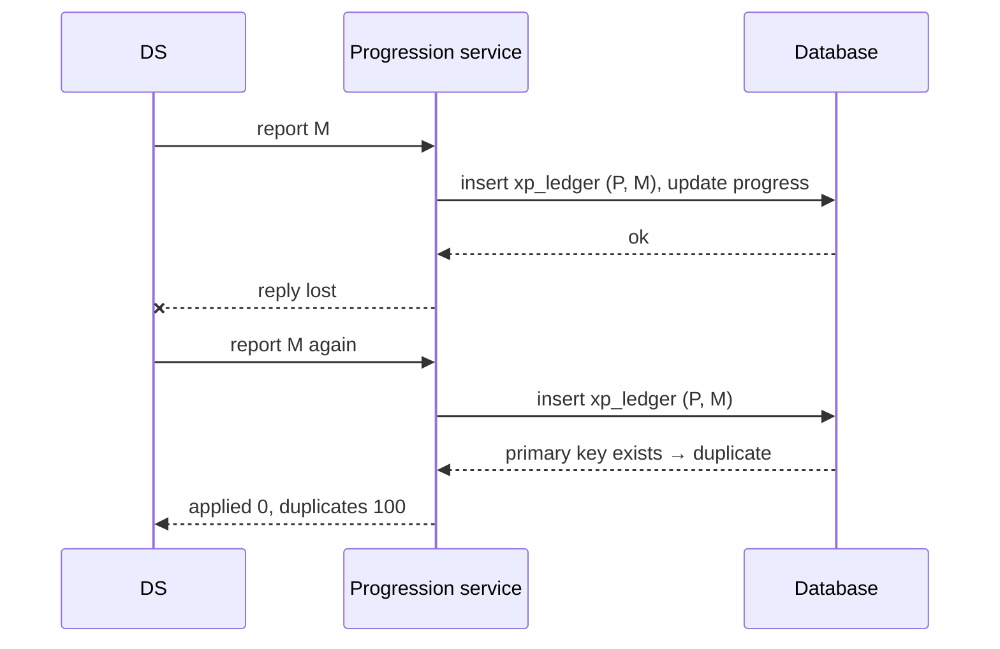

The guard: `xp_ledger` has primary key `(player_id, match_id)`, inserted in
the same transaction as the XP change. A match pays a player at most once.

**2. Two writes race for the same player.** For example a retried report
arrives while the first is still running, or another feature (an event
bonus) adds XP at the same moment.

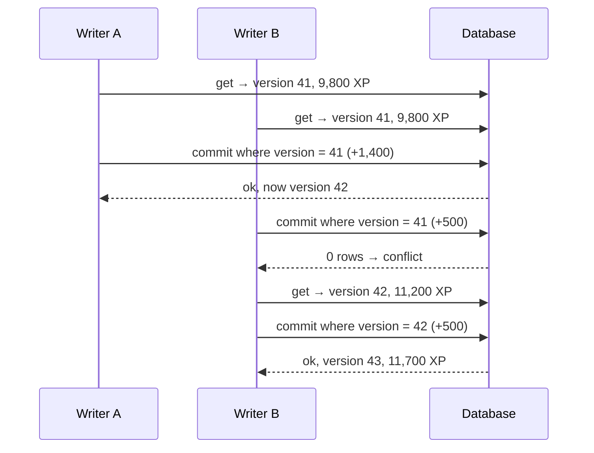

The guard: `UPDATE ... WHERE version = <what we read>`. A write based on an
old read changes nothing and is retried from a fresh read. Neither gain is
lost.

**3. A level-up must be announced if and only if it was saved.** See
[section 7](#7-telling-the-client-level-up-events).

### A whole match

`settleMatch` settles up to 100 players **in parallel**: they are
independent. One player's failure does not block the other 99. Failed
players are returned, and the DS (or a retry job) sends the **same**
report again: the players who already succeeded come back as duplicates.

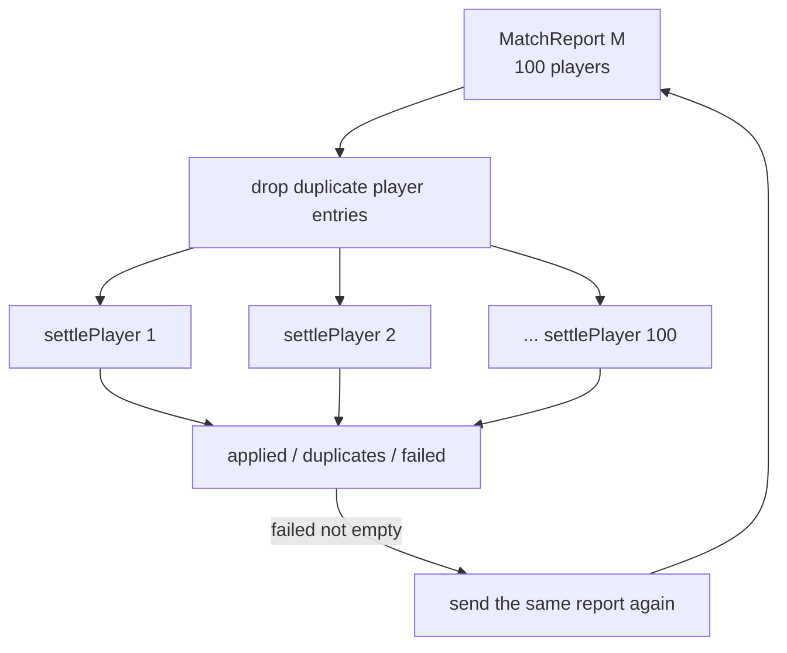

---

## 7. Telling the client: level-up events

A level-up should show a pop-up in the client and maybe unlock a season
pass reward. Calling the push channel **inside** settlement would go wrong
both ways:

| Order | Failure | Result |
|---|---|---|
| Save, then push | Crash after saving | Level saved, never announced |
| Push, then save | Save fails | Announced a level that does not exist |

So settlement writes the event into `progress_outbox` **in the same
transaction** as the XP. A separate relay job sends it:

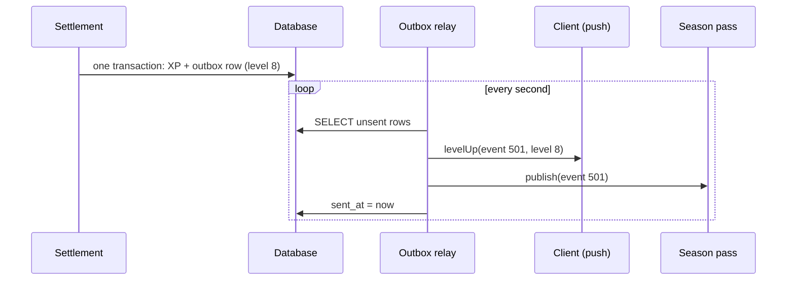

Delivery is **at least once**: if the job crashes after sending but before
marking the row sent, it sends again. Consumers ignore an `eventId` they
have already seen. An offline player sees their new level the next time
the client calls `getMyProgress`.

---

## 8. RPC contracts

Defined in [`src/ports.ts`](src/ports.ts).

### DS → backend: `reportMatchResult`

```ts
reportMatchResult(report: MatchReport)
  → { applied: number; duplicates: number; failed: PlayerId[] }

MatchReport = {
  matchId: string;
  endedAt: number;
  players: { playerId, minutesPlayed, completed, kills, revives,
             suppliesDelivered, fortificationsBuilt, teamKills }[];
}
```

- **Only DS identities may call it.** A game client calling it could award
  itself XP.
- **Raw facts in, no XP.** The backend owns the rules.
- **Safe to retry** with the same `matchId`.

### Client → backend: `getMyProgress`

```ts
getMyProgress(sessionPlayerId) → ProgressView

ProgressView = {
  level: 8, maxLevel: 100, totalXp: 11200,
  xpIntoLevel: 1050,          // 11,200 − 10,150 (floor of level 8)
  xpForThisLevel: 2050,       // null at max level
}
```

- **The player comes from the session**, never from a parameter: a client
  cannot ask for, or pretend to be, someone else.
- The server computes the bar's numbers (`viewOf`), so the client never
  needs the curve and cannot show a wrong bar after a rebalance.

### Backend → client: `levelUp` push

```ts
LevelUpEvent = { eventId, playerId, level, matchId }
```

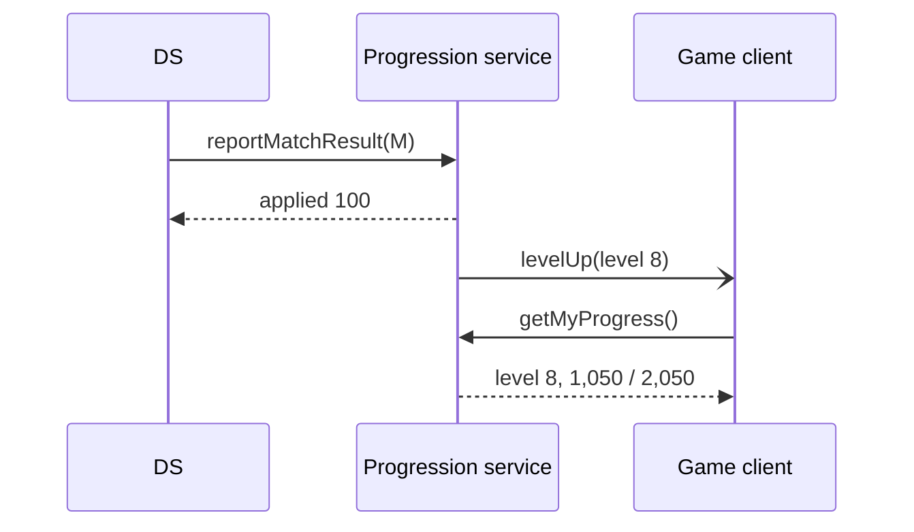

---

## 9. Database

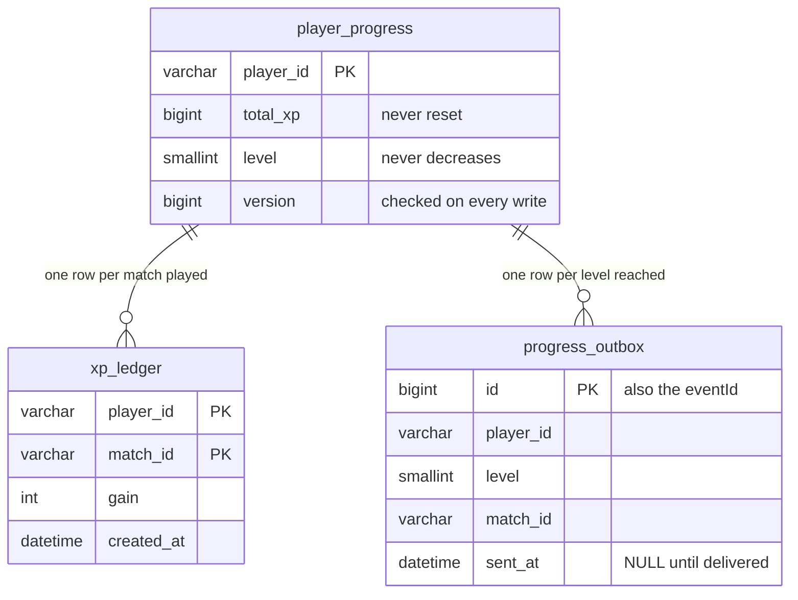

Full SQL: [`sql/schema.sql`](sql/schema.sql).

| Table | Guarantees |
|---|---|
| `player_progress` | Current state. `version` makes concurrent writes safe. |
| `xp_ledger` | Primary key `(player_id, match_id)`: a match pays a player once. Also the audit trail ("why do I have this much XP?") and the input for re-computing XP if a rule bug is found. |
| `progress_outbox` | Level-ups saved together with the XP, delivered later. |

---

## 10. Mapping to TcaplusDB

On InGame, data lives in TcaplusDB, a key-value store. Without multi-row
transactions, the three tables collapse into **one record per player**:

```
key:    player_id
value:  {
  total_xp:     11200,
  level:        8,
  recent_matches: ["M-1041", "M-1040", ...],   // last 50 match ids
  pending_events: [{ id, level: 8, match: "M-1041" }],
}
version: 42     // the store's record version, checked on write
```

| SQL design | Key-value design |
|---|---|
| `xp_ledger` primary key | `recent_matches` inside the record: a match already listed is a duplicate |
| `UPDATE ... WHERE version = ?` | The store's conditional write on the record version (**assumption**: TcaplusDB's version check) |
| `progress_outbox` rows | `pending_events` inside the record, removed by the relay after delivery |

Everything changes in **one write of one record**, so it stays atomic. The
cost: duplicates are only caught within the last 50 matches. That is
plenty for a DS retry, which comes within seconds. A full ledger, if
needed for audits, goes to a separate log store.

---

## 11. A worked example

A medic at level 7 with 9,800 XP finishes a 60-minute match with 3 kills
and 10 revives. The DS's first report times out and it retries.

| Step | What happens | Total XP | Level | Version |
|---|---|---|---|---|
| 0 | Before the match | 9,800 | 7 | 41 |
| 1 | `computeMatchXp`: 600 + 200 + 60 + 500 | | | |
| 2 | `applyGain(+1,360)` → 11,160 ≥ 10,150 (floor of 8) | 11,160 | **8** | 42 |
| 3 | Commit: ledger (P, M), progress, outbox "level 8" | 11,160 | 8 | 42 |
| 4 | Reply to the DS is lost; the DS sends report M again | | | |
| 5 | Ledger insert (P, M) hits the primary key → **duplicate** | 11,160 | 8 | 42 |
| 6 | Relay pushes "level 8" to the client | | | |
| 7 | Client calls `getMyProgress` | 11,160 | 8 | 1,010 / 2,050 |

A bigger jump crosses two levels at once: a player with 4,800 XP (level 4)
who earns 1,800 reaches 6,600, past the floors of level 5 (4,900) and
level 6 (6,500). `levelUps` is `[5, 6]` and two events are queued.

---

## 12. The code

```
sql/
  schema.sql     player_progress, xp_ledger, progress_outbox
src/
  types.ts       PlayerProgress, PlayerMatchStats, MatchReport, ProgressView, LevelUpEvent
  curve.ts       MAX_LEVEL, xpToNext, LEVEL_FLOOR, levelFor, viewOf        ← implemented
  xp.ts          XP_RULES, computeMatchXp                                  ← implemented
  settle.ts      applyGain, settlePlayer, settleMatch                      ← implemented
  ports.ts       ProgressStore, OutboxRelay, ClientNotifier,
                 PlatformEventSink, MatchResultRpc, ProgressRpc            ← interfaces
```

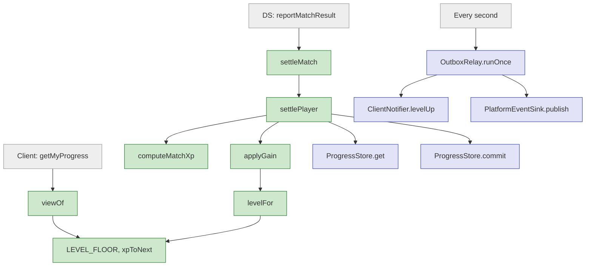

Green: implemented. Blue: interface only. Grey: callers.

**Reading order:** `curve.ts` → `xp.ts` → `settle.ts` (`applyGain` first,
then `settlePlayer`) → `ports.ts` (`ProgressStore.commit` explains the
transaction) → `sql/schema.sql`.

---

## 13. Assumptions and limitations

**Assumptions:**

- This is a simulation. The curve, the XP rules and every number are
  **invented**. The real game's progression mechanics are not public, and
  no launch announcement for the China edition was found when this was
  written (2026-10-18).
- Most China-edition sources are media coverage of a pre-launch preview.
  Some of it reads as promotional; section 1 marks each claim by how solid
  it is. Systems may change before or after launch.
- How the DS calls backend services on InGame, how clients are pushed
  messages, and whether BattlePass/Statistics accept our events are not
  publicly documented.
- TcaplusDB's conditional write on record version is assumed for the
  key-value mapping.

**Limitations:**

- **No seasons, medals or rewards per level.** They would read the same
  match report and the same level-up events; that is the point of the
  outbox.
- **No rule versioning.** If `XP_RULES` change, old matches are not
  recomputed. `xp_ledger.gain` records what was actually paid.
- **No anti-abuse beyond caps.** Detecting farmed matches (e.g. two
  friends idling on an empty server) needs match-level checks.
- **Scaling** (sharding players across pods, safe handoff on scale-down)
  is the subject of the separate
  [stateful shard handoff demo](https://github.com/zhanghanqing/stateful-shard-handoff).

---

## 14. Sources

All checked on 2026-10-18.

**Global edition (official)**

- [Squad developer Q&A, March 2024](https://www.joinsquad.com/updates/squad-developer-q-a---march-2024): no traditional progression planned; a social one planned
- [Squad 9.0 release notes, 2025-09-04](https://www.joinsquad.com/updates/squad-9-0-release-notes): the Commendation System
- [Squad Wiki: Server browser](https://squad.fandom.com/wiki/Server_browser) (community wiki)

**China edition (media, pre-launch)**

- [Chuapp, 2026-05-27](https://www.chuapp.com/article/291383.html): showcase, preview build, the producer on 军旅之路
- [游戏日报 via Sohu, 2026-05-28](https://www.sohu.com/a/1028663636_118576): hands-on preview; progression, ranked, career, medals, team-kill warnings and reports
- [游研社 via Sohu, 2026-05-29](https://m.sohu.com/a/1029470443_628730/): 39 medals, matchmaking, free-to-play, plans for 军旅之路
- [17173, 2026-05-30](https://news.17173.com/content/05302026/152503790.shtml): 39 medal types (from a WeChat account, promotional in tone)
- [Baidu Baike](https://baike.baidu.com/item/%E6%88%98%E6%9C%AF%E5%B0%8F%E9%98%9F%EF%BC%9A%E7%A0%B4%E6%99%93%E6%94%BB%E5%8A%BF/65814456): developer, publisher, licence date
- [Official site](https://sigua.qq.com/)
